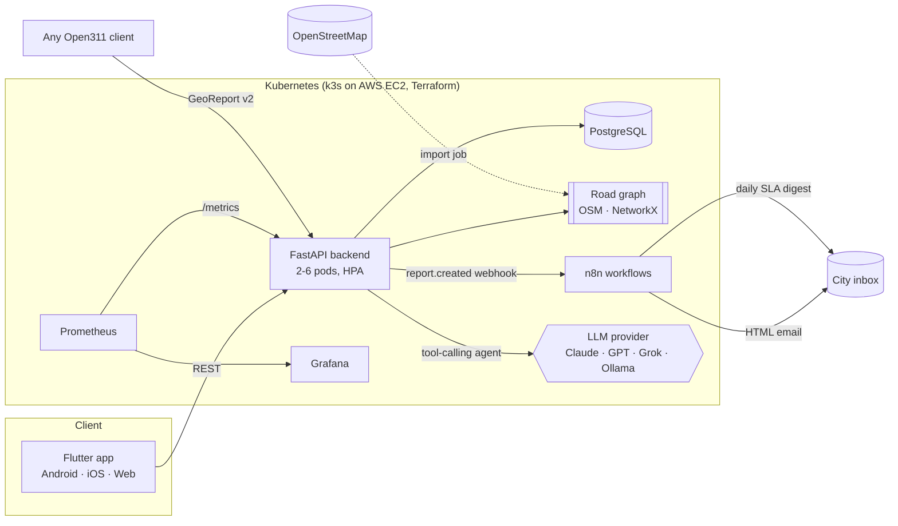

# 🌿 Sfax Eco-Route v2

**Citizen reporting + road-network intelligence for Grand Sfax, Tunisia.**
Citizens report problems (waste, potholes, broken lights, flooding…). The platform snaps each report onto the real road graph, scores it with an explainable engineering model, routes it to the responsible service by email (n8n), routes citizens *around* problems, and gives them an AI assistant that tells them what to do — safely.

> v1 (2025) was an Android Studio app: a form with 5 categories, 8 hard-coded zones and a counter dashboard.
> v2 is a full platform: Flutter app · FastAPI · graph theory on the complete OSM road network · engineering decision layer · multi-LLM agent · n8n automation · Docker/Kubernetes/Terraform/CI/CD · Prometheus/Grafana.

**Status:** working prototype that runs locally. Not deployed and not used by real citizens yet. Built as a personal project and project report at ISIMSF (Licence Appliquée Big Data, 2025–2026).

<!-- Add screenshots, then remove the comment markers on the lines below:
| Map | Report | Dashboard | Assistant |
|---|---|---|---|
|  |  |  |  |
-->

---

## Architecture



**Life of a report:** photo + description → AI triage (category, danger) → snapped to the nearest road segment → duplicate check (60 m, same category → merged as a confirmation) → priority score from 5 factors → SLA + responsible service + cost estimate → n8n emails the city inbox → shows on the map, hotspots, road health index, crew tour.

---

## What's inside

### 1. The whole road network, not 8 zones
`scripts/import_osm.py` downloads **every drivable street in Grand Sfax** from OpenStreetMap (Sfax, Sakiet Ezzit, Sakiet Eddaïer, Chihia, Gremda, El Aïn, Thyna…) — tens of thousands of segments with names, road class and speed limits. Reports are snapped to the nearest segment by vectorised point-to-segment projection, so "zone" is no longer a dropdown: it is computed. Without the import (tests, CI) a schematic graph of the 11 radial routes (Tunis, Teniour, Saltnia, Mahdia, Menzel Chaker, Gremda, Lafrane, l'Aïn, Aéroport, Soukra, Gabès) and the ring roads is used.

### 2. Graph theory layer — `backend/app/graph/road_graph.py`
| Concept | Used for |
|---|---|
| **Edge betweenness centrality** (sampled, on travel time) | How many shortest paths cross a segment → how much a problem there hurts the city |
| **Bridges** (edges whose removal disconnects the graph) | Segments with *no alternative route* → criticality ≥ 0.9 |
| **Dijkstra with hazard-weighted edges** | *Eco-route*: fastest path vs. path that avoids open reports (soft penalty `t·(1+k·severity)`) |
| **Edge-removal what-if** | "If this road closes": detour length/time, isolated intersections, % of simulated trips delayed |
| **TSP (nearest-neighbour + 2-opt)** over shortest-path distances | Visiting order for a maintenance crew across N reports |
| **Cyclomatic number** `E − V + C` | Network redundancy KPI on the dashboard |

### 3. Engineering decision layer — `backend/app/engineering/scoring.py`
```
priority = 100 × (0.30·severity + 0.20·citizen_urgency + 0.25·road_criticality + 0.15·crowd + 0.10·age)
crowd    = log(1+confirmations)/log(11)       # diminishing returns
age      = min(1, age_h / SLA)                # escalates while it waits
SLA      = base_SLA(category) × (1 − 0.5·criticality)   # arterials get fixed faster
danger to people (live wire, fire, children) ⇒ priority ≥ 75 (critical), SLA ≤ 4 h
```
Every score ships with its **breakdown**, so a decision can be justified. Plus: per-category responsible service (Municipalité, STEG, SONEDE, ONAS, ANPE, Direction Régionale de l'Équipement…), cost range in TND, crew hours, **DBSCAN hotspots** (250 m), a **Road Health Index** per named road, SLA breach tracking and mean time to resolve.

### 4. AI assistant — `backend/app/ai/`
One env var switches provider: `LLM_PROVIDER=claude | openai | grok | ollama | none`.
OpenAI, Grok (xAI) and Ollama share the OpenAI chat-completions protocol; Claude uses the Anthropic Messages API. Plain `httpx`, no vendor SDK. Both tool-calling loops are unit-tested against mocked HTTP.

The assistant is a **tool-using agent**, grounded in real data instead of guessing:
`get_safety_protocol` (verified steps, not generated) · `emergency_numbers` (198 / 190 / 197 / 193) · `nearby_reports` · `road_closure_impact` · `safe_route` · `draft_report` (the citizen confirms it in the app).
It answers in French, Tunisian darija or English. With `none`, a rule-based fallback still gives safety steps and a draft — the app never depends on a paid key.

### 5. n8n automation — `n8n/workflows/`
- **Report intake:** webhook → branded HTML email to the city inbox you configure in the workflow (priority badge, danger banner, AI summary, responsible service, map link) → optional Telegram alert for critical reports.
- **Daily SLA digest (08:00 Africa/Tunis):** pulls the dashboard + overdue reports from the API and emails a summary.

The backend only emits events; routing rules live in n8n and can change without a deploy. If n8n is down, the backend falls back to direct SMTP.

### 6. Open311 compatible
`/open311/v2/services.json` and `/open311/v2/requests.json` implement the GeoReport v2 standard used by FixMyStreet and SeeClickFix, so existing city back-offices and clients can plug in.

### 7. DevOps
| Layer | Implementation |
|---|---|
| Containers | Multi-stage Dockerfile, non-root user, healthcheck |
| Local stack | `docker compose`: API, Postgres, n8n (auto-imports workflows), Prometheus, Grafana, optional Ollama |
| Orchestration | Kustomize: StatefulSet Postgres, Deployment (rolling, zero downtime), HPA 2→6, PDB, liveness/readiness/startup probes, read-only root FS, OSM import Job, Traefik ingress |
| IaC | Terraform: EC2 + Elastic IP + security group (SSH/API restricted to your IP), IMDSv2, encrypted gp3, k3s via user-data, **AWS budget alert** |
| CI/CD | GitHub Actions: ruff + pytest with coverage · Flutter analyze/test/**APK artifact** · terraform validate · kubeconform · compose check → build & push to GHCR (SHA tags, layer cache) → Trivy CVE scan → `kubectl apply` + rollout wait + smoke test |
| Observability | `/metrics` (HTTP + business metrics: reports by category, open by priority, SLA breaches, AI calls by provider), provisioned Grafana dashboard, Prometheus alert rules |

---

## Run it

### Local, everything in Docker
```bash
cp .env.example .env                 # set passwords; LLM_PROVIDER=none works without any key
docker compose up -d --build
docker compose run --rm osm-import   # one-time: full Sfax road network (a few minutes)
docker compose restart backend
```
- API docs: http://localhost:8000/docs
- n8n: http://localhost:5678 → open each workflow, create an **SMTP credential** named `Eco-Route SMTP` (Gmail: smtp.gmail.com:465, SSL, your address + an [App Password](https://myaccount.google.com/apppasswords)), then **Activate** both workflows.
- Grafana: http://localhost:3000

Local LLM instead of a paid API:
```bash
docker compose --profile ai up -d && docker compose exec ollama ollama pull qwen2.5:7b
# .env: LLM_PROVIDER=ollama
```

### Backend only (dev)
```bash
cd backend && pip install -r requirements.txt pytest && pytest -q
uvicorn app.main:app --reload
```

### Mobile app
```bash
cd mobile
flutter create . --org tn.ecoroute --project-name eco_route --platforms=android,ios,web   # generates platform folders, keeps ours
flutter pub get
flutter run --dart-define=API_URL=http://10.0.2.2:8000        # Android emulator → your machine
```
Screens: **Carte** (reports coloured by priority, DBSCAN hotspots, *Itinéraire* mode = fastest vs eco-route, *Fermeture* mode = tap a road to simulate its closure) · **Signaler** (AI auto-category, GPS + map pin, urgency, camera, priority breakdown after sending, duplicate merge) · **Tableau de bord** (KPIs, categories, hotspots, road health, SLA breaches, network stats) · **Assistant** (chat, tools used, one-tap "create this report").

### Deploy to AWS
```bash
cd infra/terraform && cp terraform.tfvars.example terraform.tfvars   # your IP + budget email
terraform init && terraform apply
$(terraform output -raw fetch_kubeconfig) && export KUBECONFIG=$PWD/kubeconfig
kubectl create namespace eco-route
kubectl -n eco-route create secret generic ecoroute-secrets --from-literal=...   # see infra/k8s/secret.example.yaml
sed -i 's/HOST/<ip>.nip.io/' ../k8s/ingress.yaml && sed -i 's#ghcr.io/OWNER#ghcr.io/<you>#' ../k8s/*.yaml
kubectl apply -k ../k8s
```
For push-to-deploy, add the `KUBECONFIG_B64` secret and set the repo variable `DEPLOY_ENABLED=true`.
Cost: a t3.medium in eu-west-3 is roughly $30/month if left running — `terraform destroy` after demos; the budget alert warns you.
The AWS deployment is provided as infrastructure code and has not been run as a public service.

---

## API overview
| Method | Path | |
|---|---|---|
| POST | `/api/v1/reports` | Create (AI triage, snapping, dedup, scoring, n8n event) |
| GET | `/api/v1/reports` · `/{id}` | List / detail with SLA status and audit trail |
| POST | `/api/v1/reports/{id}/upvote` · `/photos` | Confirm · upload photo |
| PATCH | `/api/v1/reports/{id}/status` | Workflow: triaged → assigned → in_progress → resolved |
| POST | `/api/v1/graph/route` | Fastest vs hazard-avoiding route, CO₂ estimate |
| GET | `/api/v1/graph/closure-impact` | What-if a road closes |
| POST | `/api/v1/graph/crew-tour` | TSP tour for a maintenance crew |
| GET | `/api/v1/graph/stats` · `/roads` · `/critical-edges` | Network analytics |
| GET | `/api/v1/analytics/dashboard` · `/hotspots` · `/road-health` · `/sla-breaches` | Engineering KPIs |
| POST | `/api/v1/assistant/chat` · `/triage` | AI agent · text classification |
| GET/POST | `/open311/v2/*` | GeoReport v2 |
| GET | `/healthz` · `/readyz` · `/metrics` | Ops |

## Similar products and what Eco-Route adds
- **FixMyStreet** (UK) / **SeeClickFix** (US): citizen reporting routed to councils. Eco-Route speaks their Open311 protocol and adds road-graph criticality scoring.
- **Waze**: routes around hazards for drivers. Eco-Route does the same with *civic* hazards and gives the city the inverse view (which closures hurt the network most).
- None of them ship a safety-first AI assistant or a crew-routing optimiser in the citizen app.

## Security
**In place**
- Containers run as a non-root user with a read-only root filesystem; Kubernetes probes and a pod disruption budget.
- Terraform security group restricts SSH and API access to the owner's IP; IMDSv2 enforced; encrypted volumes.
- CI scans the built image for known vulnerabilities (Trivy) before deployment.
- Secrets come from environment variables and Kubernetes secrets, never from the repository (`.env.example` only).
- User text is escaped before it is placed in the n8n email template.
- The AI assistant cannot act on its own: it only *drafts* a report, which the citizen must confirm in the app. Safety steps come from a verified protocol list, not from generated text.

**Not yet done (planned hardening)**
- Citizen accounts, authentication and role-based access (for example, only a service role may change a report's status).
- Rate limiting and abuse protection on report creation, upvotes and photo upload.
- Strict validation of uploaded files and removal of photo metadata (EXIF).
- Systematic tests for prompt injection against the assistant, and a full security test plan (OWASP Top 10 mapping, fuzzing the API).

## Limitations
- The priority weights (0.30 / 0.20 / 0.25 / 0.15 / 0.10) are set by hand from reasoning about the problem. They are not calibrated or validated against real municipal data.
- The AI features are an integration layer over existing language models (plus rule-based fallbacks). No model is trained in this repository.
- Duplicate detection uses distance and category only (60 m, same category); it does not yet compare photos or text.
- Tested on development data; no real-world usage or user study yet.

## Roadmap
PostGIS (`ST_ClusterDBSCAN`, spatial indexes) · Alembic migrations · citizen accounts and push notifications on status change · public open-data export · the security items above ·
**Research direction:** automatic validation of reports from photo and multilingual text (Tunisian Arabic, French, English): relevance, category, severity and duplicate detection, with a labelled Tunisian dataset and a measured evaluation · full right-to-left review of the Arabic interface.

## Tests
`backend/tests`: graph algorithms (bridges, detours, eco-route, TSP), scoring model, duplicate merge, DBSCAN, both LLM tool-calling protocols (mocked), full API flow, Open311, metrics — 27 tests. `mobile/test`: model parsing.
